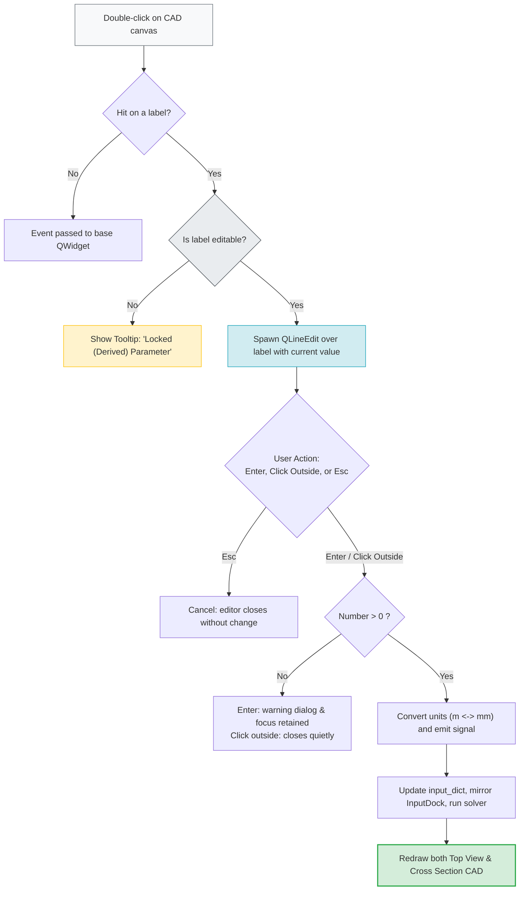
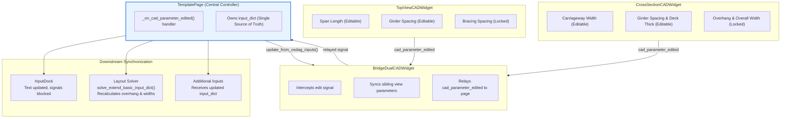
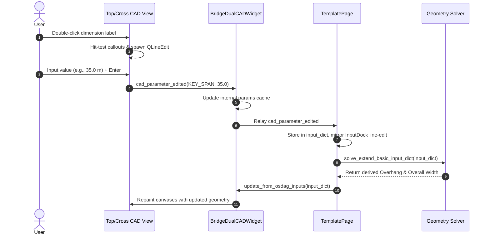
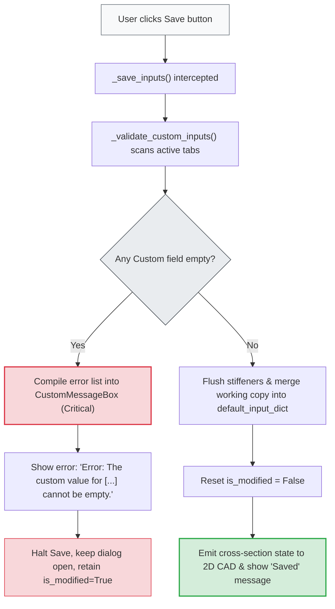
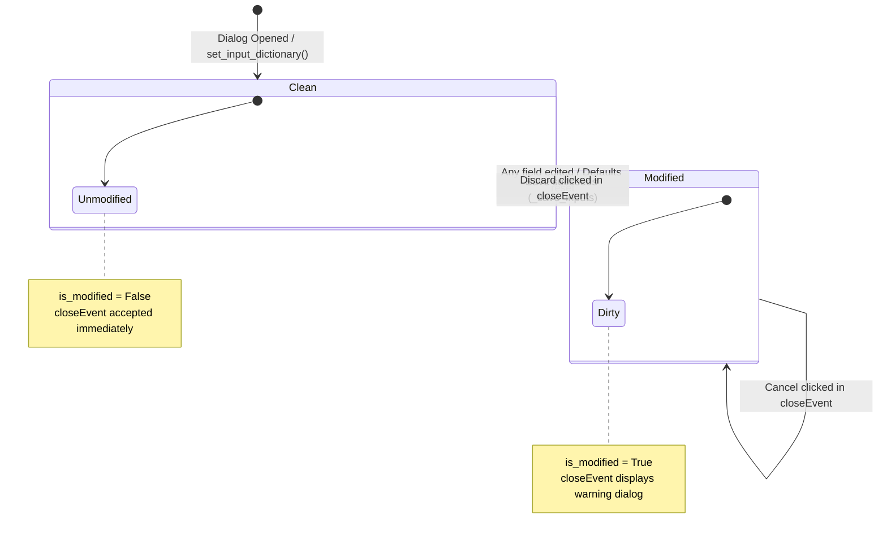
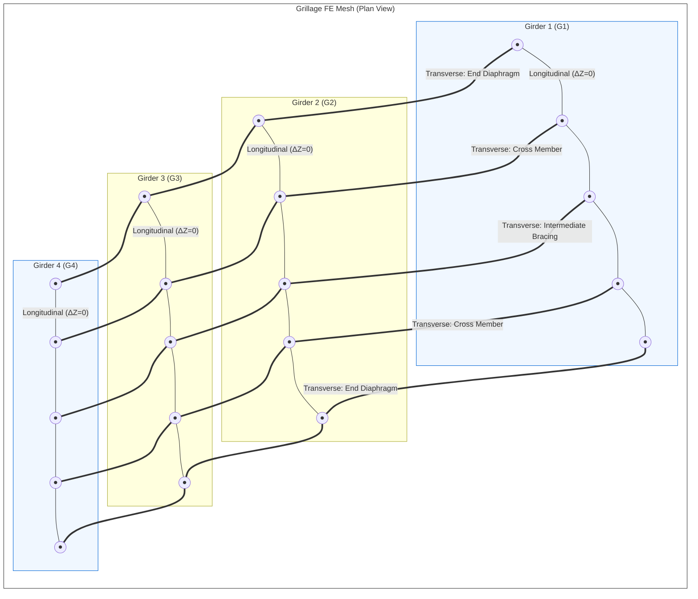
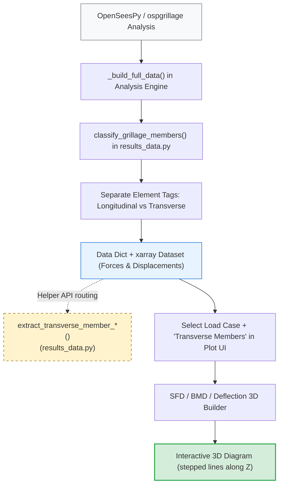

# OsdagBridge: UI, 2D CAD, and Plotting Enhancements

[](https://www.python.org/)
[](https://doc.qt.io/qtforpython-6/)
[](https://openseespydoc.readthedocs.io/)
[](https://docs.pytest.org/)
[](https://osdag.fossee.in/)
[](LICENSE)

> **Screening Task Project** for the **FOSSEE Winter Internship 2026** (IIT Bombay)  
> **Candidate:** Ritesh Jadhav  
> **Repository:** [https://github.com/THERITESHJADHAV/OsdagBridge-fosse-Internship](https://github.com/THERITESHJADHAV/OsdagBridge-fosse-Internship)  
> **Branch Target:** `dev` (Upstream: `Nidhikhare12/OsdagBridge:dev`)  
> **Documentation:** [OsdagBridge_Screening_Task_Report.pdf](docs/report/OsdagBridge_Screening_Task_Report.pdf) | [Markdown Report](docs/report/OsdagBridge_Screening_Task_Report.md)

---

## Table of Contents

- [Overview](#overview)
- [Summary of Enhancements](#summary-of-enhancements)
- [Subtask I: Interactive 2D CAD Parameter Editing](#subtask-i-interactive-2d-cad-parameter-editing)
  - [Problem Statement & Approach](#problem-statement--approach)
  - [Editable vs. Locked Parameters](#editable-vs-locked-parameters)
  - [Signal Flow & Architecture](#signal-flow--architecture)
  - [Diagrams & Flowcharts](#subtask-i-diagrams)
- [Subtask II: Additional Inputs Dialog: Validation & State Management](#subtask-ii-additional-inputs-dialog-validation--state-management)
  - [Problem Statement & Approach](#subtask-ii-problem-statement--approach)
  - [Validation Matrix & Rules](#validation-matrix--rules)
  - [Unsaved Changes Interception](#unsaved-changes-interception)
  - [Diagrams & State Machine](#subtask-ii-diagrams)
- [Subtask III: Result Plotting for Transverse Members](#subtask-iii-result-plotting-for-transverse-members)
  - [Problem Statement & Approach](#subtask-iii-problem-statement--approach)
  - [Geometric Member Classification](#geometric-member-classification)
  - [Data Extraction Routing via `results_data.py`](#data-extraction-routing-via-results_datapy)
  - [3D Diagrams & Plot Generator](#3d-diagrams--plot-generator)
  - [Diagrams & Data Flow](#subtask-iii-diagrams)
- [Automated Verification & Test Suite](#automated-verification--test-suite)
- [Installation & How to Run](#installation--how-to-run)
  - [Environment Setup](#1-environment-setup)
  - [Launching the Application](#2-launching-the-application)
  - [Running Tests](#3-running-unit-tests)
- [Project Directory Structure](#project-directory-structure)
- [Submission Deliverables](#submission-deliverables)
- [References](#references)

---

## Overview

[Osdag](https://osdag.fossee.in/) is a free and open-source software for the design and detailing of steel structures, developed by the **FOSSEE (Free/Libre and Open Source Software for Education) project at IIT Bombay**.

**OsdagBridge** is an advanced module/plugin for Osdag specifically dedicated to the analysis, design, and drawing generation of short-span steel-concrete composite girder bridges. It integrates:
- **PySide6 (Qt for Python)** for modern desktop GUI, dockable panels, and 2D CAD drawing views.
- **OpenSeesPy & ospgrillage** for finite-element grillage modeling, vehicle live-load distribution, and IRC-compliant structural analysis.
- **Matplotlib & xarray** for interactive 3D visualizers showing Shear Force Diagrams (SFD), Bending Moment Diagrams (BMD), and Deflections across grillage meshes.

This repository implements all three required subtasks of the **OsdagBridge UI, 2D CAD, and Plotting Enhancements** assignment.

---

## Summary of Enhancements

| Subtask | Scope & Objective | Key Technical Implementations | Verification |
| :--- | :--- | :--- | :---: |
| **Subtask I** | **Interactive 2D CAD Editing** | In-place floating `QLineEdit` on double-click; hit-testing reverse z-order; input validation ($> 0$); bidirectional synchronization between CAD views, `InputDock`, and geometry solver; derived dimension locking. | 100% Passed (Unit & GUI) |
| **Subtask II** | **Additional Inputs Validation & State** | Dirty state tracking (`self.is_modified`); pre-save traversal over all active tabs and custom groups; standardized error popups (`"Error: The custom value for '[Parameter Name]' cannot be empty."`); `closeEvent` safety warning (`Discard` / `Cancel`). | 100% Passed (Unit & GUI) |
| **Subtask III** | **Transverse Member Result Plotting** | Separation of transverse elements (end diaphragms, cross members, bracings) from longitudinal girders via node coordinates in `results_data.py`; full force ($F_x, V_y, V_z, T_x, M_y, M_z$) and displacement ($D_x, D_y, D_z$) extraction; 3D plot visualizers. | 100% Passed (Unit & Integration) |

---

## Subtask I: Interactive 2D CAD Parameter Editing

### Problem Statement & Approach
Previously, 2D CAD views (`TopViewCADWidget` and `CrossSectionCADWidget`) were purely static displays. Modifying parameters required navigating back to the input dock.

This enhancement introduces **direct in-place editing on the CAD canvas**:
1. When dimensions are rendered with `draw_text_with_background()` or `draw_vertical_dimension_with_arrow()`, a callout rectangle metadata object is saved to `self.dimension_callouts`.
2. A `mouseDoubleClickEvent` transforms screen coordinates, performs hit-testing with a 4 px padding tolerance, and resolves overlapping labels in reverse draw order.
3. If the parameter is **editable**, a floating `QLineEdit` appears directly over the label with current values pre-formatted ($m$ or $mm$).
4. Committing is supported via **Enter** or **clicking outside (FocusOut event filter)**. Invalid inputs ($\le 0$ or non-numeric) trigger a user-friendly `CustomMessageBox` warning on Enter, or dismiss quietly on click-outside.
5. Edits emit `cad_parameter_edited(param_key, value)`, synchronized bidirectionally through `BridgeDualCADWidget` up to `TemplatePage`, which updates `input_dict`, syncs the dock, re-derives dependent geometry, and repaints both views.

### Editable vs. Locked Parameters

Parameters are segregated into **independent design variables** (editable) and **geometrically derived dimensions** (locked to prevent mathematical and geometric inconsistencies):

| Parameter | CAD View | Param Key | Unit | Editable | Rationale |
| :--- | :---: | :--- | :---: | :---: | :--- |
| **Span Length** | Top | `KEY_SPAN` | m | **Yes** | Independent longitudinal span. |
| **Girder Spacing** | Top & Cross | `KEY_TS_GIRDER_SPACING` | m | **Yes** | Independent girder transverse center-to-center distance. |
| **Carriageway Width** | Cross | `KEY_CARRIAGEWAY_WIDTH` | m | **Yes** | Independent road surface width. |
| **Deck Thickness** | Cross | `KEY_TS_DECK_THICKNESS` | mm | **Yes** | Independent slab thickness. |
| **Overhang** | Cross | `KEY_TS_DECK_OVERHANG` | m | **No (Locked)** | Derived: $W_{\text{overhang}} = \frac{W_{\text{overall}} - (N - 1) \cdot S_g}{2}$. Tooltip explains locked state. |
| **Overall Bridge Width** | Cross | `KEY_TS_OVERALL_WIDTH` | m | **No (Locked)** | Derived: Sum of Carriageway, Footpaths, Barriers, and Median. |
| **Bracing Spacing** | Top | `none` | m | **No (Locked)** | Derived from structural span partition rules. |

#### Width Constraint Equation
$$\text{Overall Bridge Width} = (N - 1) \times \text{Girder Spacing} + 2 \times \text{Overhang}$$
Locking derived dimensions guarantees that the geometry solver retains a single source of truth without conflicting equations.

### Subtask I Diagrams

#### Figure 3.1: Edit Flow of a Double-Click


#### Figure 3.2: Components and Signal Path Architecture


#### Figure 3.3: Message Sequence of an Edit


---

## Subtask II: Additional Inputs Dialog: Validation & State Management

### Subtask II: Problem Statement & Approach
The Additional Inputs dialog houses comprehensive bridge configurations (crash barriers, medians, railings, wearing courses, wind load parameters, and custom plate girder dimensions). Two critical issues existed:
1. Selecting "Custom" but leaving mandatory input fields empty still allowed saving, leading to downstream solver crashes.
2. Closing the dialog without saving silently lost all changes without notifying the user.

### Validation Matrix & Rules
- **Pre-Save Interception**: Intercepts the Save button click inside `_save_inputs()`.
- **Active Tab Scrutiny**: Validates only active/enabled components set to `"Custom"` (`VALUE_CUSTOM`), avoiding false positives on hidden sections.
- **Strict Error Formatting**: Uses the exact required pattern:
  $$\text{"Error: The custom value for '[Parameter Name]' cannot be empty."}$$
- **Centralized Keys**: Eliminates magic strings by referencing constants defined in `common.py` (`KEY_CB_*`, `KEY_MD_*`, `KEY_RL_*`, `KEY_WC_*`, `KEY_WL_*`, `KEY_MP_GIRDER_*`, `KEY_DESIGN_MODE`).

| Component Group | Trigger Condition | Mandatory Fields Checked |
| :--- | :--- | :--- |
| **Crash Barrier** | `KEY_CB_TYPE == "Custom"` | Density, Width, Height, Area, Load (5 fields) |
| **Median** | `KEY_INCLUDE_MEDIAN == "Yes"` & `KEY_MD_TYPE == "Custom"` | Density, Width, Height, Area, Load (5 fields) |
| **Railing** | Footpath Enabled & `KEY_RL_TYPE == "Custom"` | Width, Height (2 fields) |
| **Railing Load** | Footpath Enabled & `KEY_RL_LOAD_MODE == "Custom"` | Load value (1 field) |
| **Wearing Course** | `KEY_WC_MATERIAL == "Custom"` | Density, Thickness (2 fields) |
| **Wind Load** | Field `.mode == "Custom"` | Gust factor, Drag coeff, Lift coeff, Areas A1/A3, Frontal live-load area, Eccentricities (9 fields) |
| **Girder Section** | `KEY_DESIGN_MODE == "Custom"` | Depth, Top/Bottom flange width & thickness, Web thickness (6 fields) |

### Unsaved Changes Interception
- Tracks a `self.is_modified` boolean flag. It flips to `True` whenever a line edit changes, a combobox index updates, tab defaults are reset, or tables are edited.
- Overrides `closeEvent(event)`. If `self.is_modified == True`, prompts the user:
  > *"You have unsaved changes. Closing this window will discard them. Do you want to proceed?"*  
  > **Buttons:** `Discard` (reverts to `default_input_dict` deep copy and closes) | `Cancel` (aborts closing).

### Subtask II Diagrams

#### Figure 4.1: Save Validation Flow


#### Figure 4.2: States of the `is_modified` Flag


---

## Subtask III: Result Plotting for Transverse Members

### Subtask III: Problem Statement & Approach
Post-analysis 3D visualizers previously plotted Shear Force Diagrams (SFD), Bending Moment Diagrams (BMD), and Deflection curves solely for longitudinal girders ($G_1, G_2, \dots, G_n$).

Subtask III introduces support for **Transverse Members** (end diaphragms, intermediate cross-members, and cross-bracings):
- Treated as **one consolidated component** in the selection dropdown (`DISP_TRANSVERSE_MEMBERS = "Transverse Members"`).
- Extracts all **9 internal force and displacement response components**:
  $$\text{Forces: } F_x, V_y, V_z, T_x, M_y, M_z \quad \vert \quad \text{Displacements: } D_x, D_y, D_z$$
- Implements spatial grouping along the longitudinal span ($X_{\text{mid}}$) to draw stepped 3D surface lines across the transverse width ($Z$).

### Geometric Member Classification
To avoid reliance on volatile solver internal tags, elements are classified geometrically using end-node coordinates:
- **Longitudinal Element**: Both connecting nodes share identical transverse coordinates ($\Delta Z < 10^{-3}\,\text{m}$) and elevation ($\Delta Y < 10^{-3}\,\text{m}$).
- **Transverse Element**: Any member that bridges across the bridge width ($\Delta Z \ge 10^{-3}\,\text{m}$). Works seamlessly on both orthogonal and skewed grillage meshes.

### Data Extraction Routing via `results_data.py`
In strict compliance with assignment architecture rules, all member classification and data extraction logic is routed through `src/osdagbridge/core/bridge_types/plate_girder/results_data.py`:
- `classify_grillage_members(nodes, members, z_tol)`: Separates element tags into longitudinal and transverse lists.
- `build_transverse_connectivity(nodes, members)`: Builds element mappings and coordinate-sorted nodes.
- `extract_transverse_member_forces(data, load_case, component)`: Pulls element forces for transverse lines.
- `extract_transverse_member_displacements(data, load_case, component)`: Pulls nodal translations ($D_x, D_y, D_z$).
- `PlateGirderAnalysisResults.build_transverse_members()`: Invokes `build_transverse_connectivity()` as the single pipeline source.

### 3D Diagrams & Plot Generator
- **Output Dock (`output_dock.py`)**: `refresh_member_dropdown()` appends `"Transverse Members"`.
- **Graph Engine (`graph_engine.py`)**: Adds `"Transverse Members"` to girder keys and aligns coordinate metrics along $Z$.
- **3D Visualizer (`plot_generator.py`)**:
  - `_get_bg_nodes_members()` filters and displays only transverse elements for the background wireframe.
  - Groups transverse members by midpoint span stations ($X = 0, X = L/4, X = L/2, \dots$) and plots 3D SFD, BMD, and Deflections.

### Subtask III Diagrams

#### Figure 5.1: Grillage Plan and Member Classification


#### Figure 5.2: Data Flow of the Transverse Plot


---

## Automated Verification & Test Suite

The implementation was validated using automated Pytest unit and integration test suites:

```bash
python -m pytest tests/unit/ -v
```

### Complete Test Matrix (20/20 Passed)

| # | Test Module | Test Name | Validated Assertion / Functionality | Result |
| :-: | :--- | :--- | :--- | :---: |
| 1 | `test_additional_inputs_validation.py` | `test_additional_inputs_initial_state` | Verifies `is_modified == False` on dialog launch | **PASSED** |
| 2 | `test_additional_inputs_validation.py` | `test_additional_inputs_modified_flag_on_update` | Verifies `is_modified == True` on field modification | **PASSED** |
| 3 | `test_additional_inputs_validation.py` | `test_custom_validation_empty_crash_barrier` | Halts save & emits required error message for empty Custom Crash Barrier | **PASSED** |
| 4 | `test_additional_inputs_validation.py` | `test_custom_validation_valid_crash_barrier` | Confirms save succeeds when all custom Crash Barrier fields are filled | **PASSED** |
| 5 | `test_additional_inputs_validation.py` | `test_custom_validation_empty_median` | Halts save when enabled Custom Median contains blank parameters | **PASSED** |
| 6 | `test_additional_inputs_validation.py` | `test_custom_validation_empty_railing` | Halts save when custom Railing geometry is incomplete | **PASSED** |
| 7 | `test_additional_inputs_validation.py` | `test_custom_validation_empty_wearing_course` | Halts save when custom Wearing Course density/thickness is blank | **PASSED** |
| 8 | `test_additional_inputs_validation.py` | `test_custom_validation_empty_wind_load` | Halts save when custom Wind Load gust factors are empty | **PASSED** |
| 9 | `test_additional_inputs_validation.py` | `test_custom_validation_empty_girder_custom` | Halts save when custom Girder dimensions are missing | **PASSED** |
| 10 | `test_additional_inputs_validation.py` | `test_close_event_unmodified` | Confirms dialog closes cleanly without prompts when `is_modified == False` | **PASSED** |
| 11 | `test_cad_interactive_editing.py` | `test_top_view_dimension_callouts` | Verifies Span/Girder Spacing editable; Bracing locked in Top View | **PASSED** |
| 12 | `test_cad_interactive_editing.py` | `test_cross_section_dimension_callouts` | Verifies Carriageway/Deck editable; Overhang/Width locked in Cross Section | **PASSED** |
| 13 | `test_cad_interactive_editing.py` | `test_dual_view_signal_forwarding` | Verifies bidirectional parameter synchronization between dual CAD canvases | **PASSED** |
| 14 | `test_transverse_results_plotting.py` | `test_find_transverse_elements_and_bg_filter` | Asserts geometric separation of transverse elements from longitudinal girders | **PASSED** |
| 15 | `test_transverse_results_plotting.py` | `test_output_dock_transverse_member_in_dropdown` | Asserts "Transverse Members" presence in Output Dock dropdown | **PASSED** |
| 16 | `test_transverse_results_plotting.py` | `test_plate_girder_analysis_results_transverse_members` | Asserts force/displacement extraction for transverse members from dataset | **PASSED** |
| 17 | `test_transverse_results_plotting.py` | `test_results_data_transverse_extraction` | Asserts extraction functions in `results_data.py` return structured tables | **PASSED** |
| 18 | `test_analyser.py` | `test_placeholder_analyser` | Core bridge grillage analyser test | **PASSED** |
| 19 | `test_designer.py` | `test_placeholder_designer` | Core bridge component designer test | **PASSED** |
| 20 | `test_io.py` | `test_placeholder_io` | Core serialization and dictionary I/O test | **PASSED** |

---

## Installation & How to Run

### 1. Environment Setup

Clone your fork and navigate into the repository:

```bash
git clone https://github.com/THERITESHJADHAV/OsdagBridge-fosse-Internship.git
cd OsdagBridge-fosse-Internship
git checkout dev
```

Create and activate the Conda environment using `environment.yml`:

```bash
conda env create -f environment.yml
conda activate osdagbridge-env
```

Install the package in editable mode:

```bash
pip install -e .
```

### 2. Launching the Application

Navigate to the source directory and launch the desktop application:

```powershell
cd src
python -m osdagbridge.desktop
```

*Or directly via PowerShell in the repository root:*

```powershell
& "C:\Users\RITESH JADHAV\.conda\envs\osdagbridge-env\python.exe" src -m osdagbridge.desktop
```

### 3. Running Unit Tests

Run the full pytest suite:

```bash
pytest tests/unit/ -v
```

---

## Project Directory Structure

```text
OsdagBridge/
├── docs/
│   └── report/
│       ├── OsdagBridge_Screening_Task_Report.pdf  # Comprehensive 24-page final report
│       └── OsdagBridge_Screening_Task_Report.md   # Report source with embedded diagrams
├── src/
│   └── osdagbridge/
│       ├── core/
│       │   ├── bridge_types/
│       │   │   └── plate_girder/
│       │   │       ├── analysis_results.py        # build_transverse_members() routing
│       │   │       ├── graph_engine.py            # Transverse distance scaling
│       │   │       ├── plot_generator.py          # 3D SFD, BMD, Deflection visualizers
│       │   │       └── results_data.py            # Transverse classification & extraction
│       │   └── utils/
│       │       └── common.py                      # Centralized constants (VALUE_CUSTOM, etc.)
│       └── desktop/
│           └── ui/
│               ├── dialogs/
│               │   └── additional_input/
│               │       └── additional_inputs.py   # is_modified tracking & Custom validation
│               ├── docks/
│               │   ├── cad_cross_section.py       # Cross section callouts & inline editor
│               │   ├── cad_dual_view.py           # Dual CAD signal forwarding & sync
│               │   ├── cad_top_view.py            # Top view callouts & inline editor
│               │   └── output_dock.py             # Transverse Members dropdown item
│               └── template_page.py               # CAD edit handling & solver sync
├── tests/
│   └── unit/
│       ├── test_additional_inputs_validation.py   # 10 unit tests for Task II
│       ├── test_cad_interactive_editing.py        # 3 unit tests for Task I
│       └── test_transverse_results_plotting.py    # 4 unit tests for Task III
├── environment.yml                                # Conda environment specification
├── pyproject.toml                                 # Build and package metadata
└── README.md                                      # Project documentation (this file)
```

---

## Submission Deliverables

- **GitHub Repository**: [https://github.com/THERITESHJADHAV/OsdagBridge-fosse-Internship](https://github.com/THERITESHJADHAV/OsdagBridge-fosse-Internship)
- **Target Branch**: `dev`
- **Collaborator Added**: `Nidhikhare12`
- **Technical Report (PDF)**: [OsdagBridge_Screening_Task_Report.pdf](docs/report/OsdagBridge_Screening_Task_Report.pdf)
- **Technical Report (Markdown)**: [OsdagBridge_Screening_Task_Report.md](docs/report/OsdagBridge_Screening_Task_Report.md)
- **Demonstration Video**: Unlisted YouTube Video

---

## References

1. **FOSSEE Osdag Project**: [https://osdag.fossee.in](https://osdag.fossee.in)
2. **Upstream Repository**: [https://github.com/Nidhikhare12/OsdagBridge](https://github.com/Nidhikhare12/OsdagBridge)
3. **Qt for Python (PySide6)**: [https://doc.qt.io/qtforpython-6/](https://doc.qt.io/qtforpython-6/)
4. **OpenSeesPy Documentation**: [https://openseespydoc.readthedocs.io](https://openseespydoc.readthedocs.io)
5. **ospgrillage Documentation**: [https://ospgrillage.readthedocs.io](https://ospgrillage.readthedocs.io)
6. **IRC:5-2015**: *Standard Specifications and Code of Practice for Road Bridges, Section I (General Features of Design)*.
