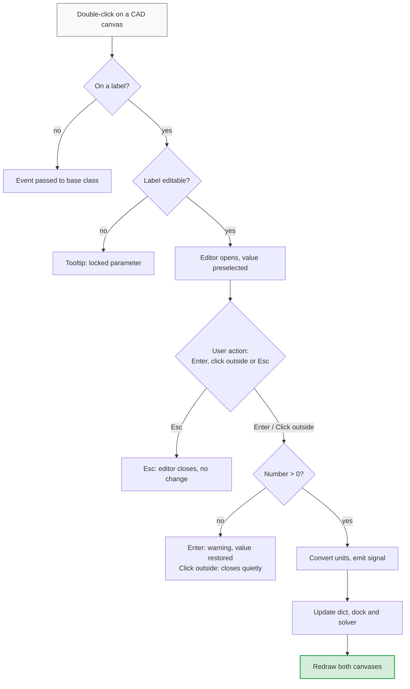
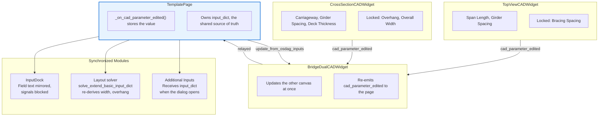
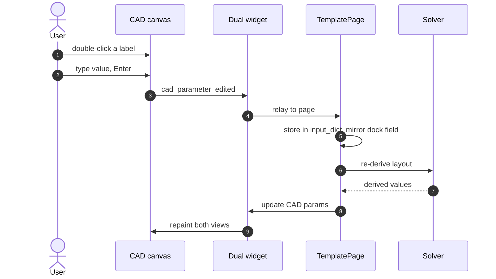
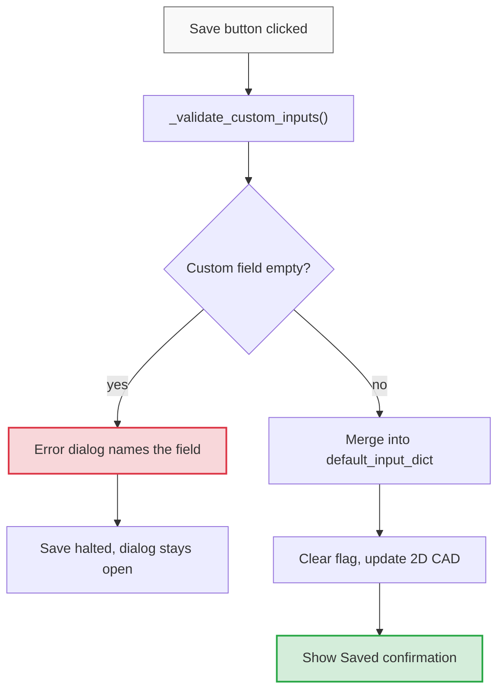
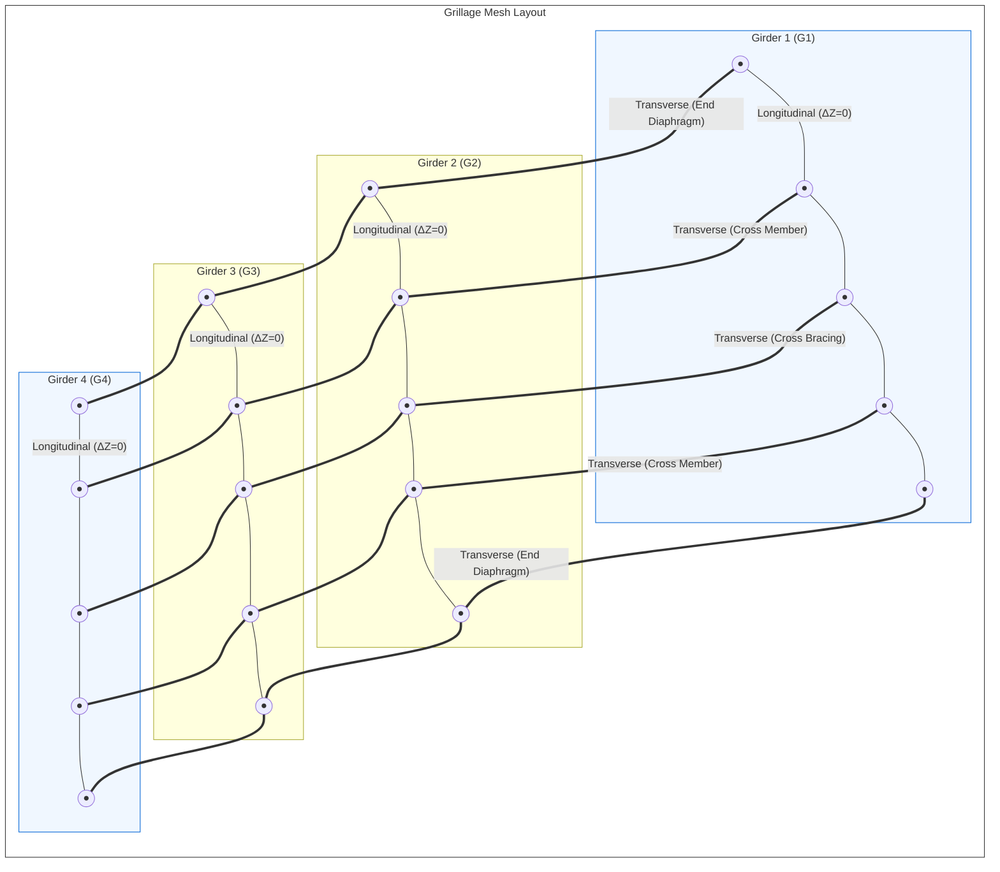
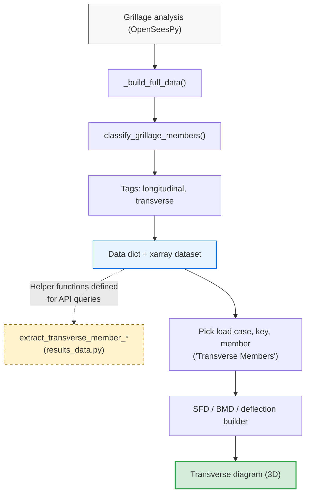

# OsdagBridge: UI, 2D CAD and Plotting Enhancements

**Screening Task Report, FOSSEE Winter Internship 2026**

| Items | Details |
| :--- | :--- |
| **Name** | Ritesh Jadhav |
| **Project** | OsdagBridge |
| **Screening task** | OsdagBridge UI, 2D CAD and Plotting Enhancements |
| **Subtask I** | Interactive 2D CAD Parameter Editing |
| **Subtask II** | Additional Inputs Dialog: Validation and State Management |
| **Subtask III** | Result Plotting for Transverse Members |
| **GitHub repository** | [https://github.com/THERITESHJADHAV/OsdagBridge-fosse-Internship](https://github.com/THERITESHJADHAV/OsdagBridge-fosse-Internship) |
| **Demo video** | [Unlisted YouTube Link] |
| **Date** | 21 November 2026 |

---

## INDEX

| # | Contents | Page No. |
| :---: | :--- | :---: |
| **1** | **Introduction** | **3** |
| | 1.1 About Osdag and OsdagBridge | 3 |
| | 1.2 Objectives | 3 |
| | 1.3 Tools and technologies | 3 |
| **2** | **Summary** | **4** |
| **3** | **Subtask I: Interactive 2D CAD Parameter Editing** | **5** |
| | 3.1 Problem statement | 5 |
| | 3.2 Requirements | 5 |
| | 3.3 Approach | 6 |
| | 3.4 Implementation | 6 |
| | 3.5 Diagrams | 10 |
| **4** | **Subtask II: Additional Inputs Dialog: Validation and State Management** | **12** |
| | 4.1 Problem statement | 12 |
| | 4.2 Requirements | 12 |
| | 4.3 Approach | 13 |
| | 4.4 Implementation | 13 |
| | 4.5 Diagrams | 16 |
| **5** | **Subtask III: Result Plotting for Transverse Members** | **17** |
| | 5.1 Problem statement | 17 |
| | 5.2 Requirements | 17 |
| | 5.3 Approach | 18 |
| | 5.4 Implementation | 18 |
| | 5.5 Diagrams | 20 |
| **6** | **Conclusion** | **22** |
| **7** | **References** | **23** |

---

## List of Figures

| Figure | Title | Page No. |
| :---: | :--- | :---: |
| **3.1** | Edit flow of a double-click | 10 |
| **3.2** | Components and signal path | 11 |
| **3.3** | Message sequence of an edit | 11 |
| **4.1** | Save validation flow | 16 |
| **4.2** | States of the is_modified flag | 16 |
| **5.1** | Grillage plan and member classification | 20 |
| **5.2** | Data flow of the transverse plot | 21 |

---

## 1. INTRODUCTION

### 1.1 About Osdag and OsdagBridge
Osdag is a free and open-source software for the design and detailing of steel structures. It is developed by the FOSSEE project at IIT Bombay. OsdagBridge is a plugin for Osdag. It is being built to analyse and design short-span steel girder bridges.

In OsdagBridge the user enters the bridge details in an input dock. The software shows the bridge as two 2D drawings (a top view and a cross-section), runs a grillage analysis using OpenSeesPy and ospgrillage, and then shows the results as tables and plots.

### 1.2 Objectives

| Subtask | Objective |
| :--- | :--- |
| **I** | Let the user edit the main bridge dimensions by double-clicking the labels on the 2D CAD drawing, and keep the main inputs in sync |
| **II** | Stop incomplete "Custom" inputs from being saved in the Additional Inputs dialog, and warn the user before unsaved changes are lost |
| **III** | Add transverse members (end diaphragms, cross bracing) to the result plots, which only showed longitudinal members before |

### 1.3 Tools and technologies

| Tool | Use in this project |
| :--- | :--- |
| **Python** | Main language of the whole project |
| **PySide6 (Qt for Python)** | Windows, docks, dialogs and the CAD widgets |
| **QPainter** | Drawing the 2D CAD views |
| **OpenSeesPy and ospgrillage** | Grillage analysis of the bridge |
| **xarray** | Holds the analysis results (load case, element, component) |
| **Matplotlib** | 3D result plots in the Plots window |
| **pytest** | Unit tests |
| **Miniconda, environment.yml** | Environment `osdagbridge-env` |
| **Git and GitHub** | Version control and submission |

---

## 2. SUMMARY

The table gives a short view of all three subtasks. The status is given against the requirements of each subtask.

| Subtask | What was done | Status | Main limitation |
| :--- | :--- | :--- | :--- |
| **I: CAD editing** | Double-click on labels opens an input box. The value goes to `input_dict`, the dock and both drawings | Works for Span Length and Carriageway Width | Girder Spacing and Deck Thickness go back to the old value after the solver runs. CAD edits are checked less than dock edits |
| **II: Dialog validation** | Save is blocked if a Custom field is empty. Closing with unsaved changes shows a Discard / Cancel warning | Warning works. Validation works partly | A cleared field can be replaced by its default before the check. Some Custom fields are not checked. Esc may skip the warning |
| **III: Transverse plots** | "Transverse Members" added to the dropdown. All nine components can be plotted | Works for normal bridges | Plot code does not use the extraction functions in `results_data.py`. Skewed bridges split the lines |

---

## 3. SUBTASK I: INTERACTIVE 2D CAD PARAMETER EDITING

### 3.1 Problem statement
The main window shows the bridge as two live drawings. Before this subtask the drawings were only for viewing. To change a dimension the user had to go to the input dock, find the field and type the value there.

The subtask asks to make this faster. When the user double-clicks a dimension label on the drawing, the label should turn into a small input box. After typing a number and pressing Enter (or clicking outside), the value should be checked, saved in the input dictionary and the drawing should be redrawn.

### 3.2 Requirements

| ID | Requirement | Where it is done |
| :---: | :--- | :--- |
| **R1** | Bind a double-click event to the text labels in the 2D CAD | `mouseDoubleClickEvent` in `cad_top_view.py` and `cad_cross_section.py` |
| **R2** | Replace the label with a temporary input box for a number | `_show_inline_editor()` creates a `QLineEdit` over the label |
| **R3** | Validate the value on Enter or click outside | `commit_value()` inside `_show_inline_editor()` |
| **R4** | Push the value to the basic and additional input dictionaries | `TemplatePage._on_cad_parameter_edited()` writes `input_dict[param_key]` |
| **R5** | Redraw the CAD after the change | `update_from_osdag_inputs()` and then `update()` |
| **R6** | Editable: Carriageway Width, Girder Spacing, Deck Thickness, Span Length | `is_editable=True` where the label is drawn |
| **R7** | Read-only: Overhang, Overall Bridge Width, Bracing Spacing | `is_editable=False`; a double-click only shows a tooltip |

### 3.3 Approach

| Decision | Choice | Reason |
| :--- | :--- | :--- |
| **How to find the clicked label** | Keep a list of label rectangles, filled while painting | The rectangles always match what is on the screen, even after zoom or resize |
| **Editing control** | A real `QLineEdit` placed over the label | Keyboard, selection and focus work without extra code |
| **Editable or locked** | A flag `is_editable` saved with each label | The rule stays next to the drawing code |
| **Sending the value out** | Qt signal `cad_parameter_edited(param_key, value)` | The drawing does not need to know about the dock or the solver |
| **Name of the parameter** | The central `KEY_*` constant from `common.py` | Same key that the dock and the solver already use |
| **Where the data lives** | `TemplatePage.input_dict` | Dock, solver and CAD all read the same dictionary |
| **Derived values** | Never editable | Avoids a drawing that contradicts itself (Section 3.4.3) |

### 3.4 Implementation

#### 3.4.1 Label list (`dimension_callouts`)
Every dimension label is drawn by `draw_text_with_background()` or, for vertical dimensions, `draw_vertical_dimension_with_arrow()`. These functions also add one record to the list `self.dimension_callouts`. The list is cleared at the start of every paint, so it always matches the current picture.

| Field | Meaning |
| :--- | :--- |
| `rect` | `QRectF` of the label background, used for hit-testing |
| `param_key` | Central key such as `KEY_SPAN`; `None` if no input is behind the label |
| `display_name` | Name shown in tooltips and messages |
| `is_editable` | `True` for editable parameters, `False` for locked ones |
| `unit` | `"m"` or `"mm"`; decides the format and the conversion |
| `current_val` | Value shown in the editor when it opens |
| `param_name` | Internal CAD name such as `span_length` |

#### 3.4.2 Editable and locked parameters

| Parameter | View | Param_key | Unit | Editable | Note |
| :--- | :--- | :--- | :---: | :---: | :--- |
| **Span Length** | Top | `KEY_SPAN` | m | Yes | Independent value |
| **Girder Spacing** | Top and Cross | `KEY_TS_GIRDER_SPACING` | m | Yes | Overhang is recalculated from it |
| **Carriageway Width** | Cross | `KEY_CARRIAGEWAY_WIDTH` | m | Yes | Drawn in three layouts (median, footpath); all three are editable |
| **Deck Thickness** | Cross | `KEY_TS_DECK_THICKNESS` | mm | Yes | Independent value |
| **Overhang** | Cross | `KEY_TS_DECK_OVERHANG` | m | No | Derived from overall width, girders and spacing |
| **Overall Bridge Width** | Cross | `KEY_TS_OVERALL_WIDTH` | m | No | Derived from carriageway, footpaths, barriers and median |
| **Bracing Spacing** | Top | `none` | m | No | Derived from the span |
| **Footpath Width and Thickness** | Cross | `various` | m, mm | No | Set in Additional Inputs |
| **Median Width** | Cross | `KEY_MD_WIDTH` | m | No | Set in Additional Inputs |

#### 3.4.3 Why the derived parameters are locked
The cross-section follows one width equation:
$$\text{Overall Bridge Width} = (N - 1) \times \text{Girder Spacing} + 2 \times \text{Overhang}$$

Here $N$ is the number of girders. The overall width is itself the sum of the carriageway, footpaths, crash barriers and median. If the user could edit Overhang, Overall Width and Spacing separately, the three values could disagree and the drawing would be impossible. With these three locked, there is only one way to change the layout: edit an independent input and let the solver calculate the dependent ones.

#### 3.4.4 Double-click handling
`mouseDoubleClickEvent` converts the click position to widget coordinates and checks `dimension_callouts` in reverse order. In this way, a label drawn later (on top) wins if two labels overlap. Each rectangle is made 4 px bigger on every side so that small labels are easier to hit.
1. If the label has `is_editable=False`, a tooltip says that it is a locked (derived) parameter and nothing else happens.
2. If the label has `is_editable=True`, the inline editor opens.
3. If no label is hit, the event goes to the base class as usual.

#### 3.4.5 Inline editor (`_show_inline_editor`)

| Step | What happens |
| :--- | :--- |
| **Clean up** | If an editor is already open it is deleted, so only one editor exists |
| **Create** | A `QLineEdit` is created as a child of the canvas with a blue 2 px border and white background |
| **Fill** | The current value is shown: two decimals for metres (35.00), none for millimetres (250) |
| **Select** | All the text is selected, so typing replaces the value |
| **Place** | Size $90 \times 26$ px, centred at the double-click position |
| **Focus** | It is shown and focused immediately |

#### 3.4.6 Commit, validation and cancel

| User action | Result |
| :--- | :--- |
| **Enter** | `commit_value(show_error=True)` runs |
| **Click outside** | An event filter sees FocusOut, waits 150 ms and calls `commit_value(show_error=False)` |
| **Esc** | The editor is deleted and nothing changes |

The 150 ms wait is there so that a focus change caused by the editor's own pop-up is not taken as a click outside.
`commit_value` accepts the text only if it is a number and it is greater than zero. If the user presses Enter with wrong text, the standard `CustomMessageBox` ("Invalid Input", warning type) names the parameter and says that it must be a positive number. The old value is put back and the box keeps the focus. If the same wrong text is left by clicking outside, the editor just closes.

When the value is accepted, the units are converted (metres $\times 1000$ gives millimetres for span, spacing and carriageway; deck thickness is already in millimetres) and the CAD widget's own parameter is updated. Then the editor is deleted, `cad_parameter_edited(param_key, new_val)` is emitted and `update()` is called.

#### 3.4.7 Passing the signal up (`BridgeDualCADWidget`)
Both drawings emit the same signal. The dual widget is connected to both. Before passing the signal on, it updates the other drawing, so that both drawings agree at once.

| Key received | Top view updated | Cross-section updated |
| :--- | :--- | :--- |
| `KEY_SPAN` | `span_length` | none (span is not shown there) |
| `KEY_TS_GIRDER_SPACING` | `girder_spacing` | `girder_spacing` |
| `KEY_CARRIAGEWAY_WIDTH` | `carriageway_width` | `carriageway_width` |
| `KEY_TS_DECK_THICKNESS` | none | `deck_thickness` |

After this it emits `cad_parameter_edited(param_key, value)` again to its parent, which is `TemplatePage`.

#### 3.4.8 Updating the input dictionary (`TemplatePage._on_cad_parameter_edited`)
1. Store the value: `self.input_dict[param_key] = value`.
2. Copy it into the input dock: find the field with `input_dock._w(param_key)` and, if it is a `QLineEdit`, set its text with signals blocked so that the dock does not treat it as a user edit.
3. Recalculate the dependent values with `solve_extend_basic_input_dict(self.input_dict)`.
4. Redraw: `cad_comp_widget.update_from_osdag_inputs(self.input_dict)` converts the dictionary back to millimetre CAD parameters and repaints both views.

Girder spacing, deck thickness, overhang and the other Typical Section values live in the same shared dictionary. The Additional Inputs dialog gets this dictionary through `set_input_dictionary(self.input_dict)` when it opens, so one write covers both the basic and the additional inputs.

#### 3.4.9 Units

| Quantity | Input dictionary | CAD widget (params) | Editor shows |
| :--- | :--- | :--- | :--- |
| **Span** | m | mm ($\times 1000$) | m, 2 decimals |
| **Girder Spacing** | m | mm ($\times 1000$) | m, 2 decimals |
| **Carriageway Width** | m | mm ($\times 1000$) | m, 2 decimals |
| **Deck Thickness** | mm | mm | mm, whole number |

### 3.5 Diagrams

#### 3.5.1 Edit flow (Figure 3.1)


*Figure 3.1: A double-click reaches the solver only for an editable label and a valid number. A locked label only shows a tooltip, and Esc or a wrong input never sends the signal.*

#### 3.5.2 Components and signal path (Figure 3.2)


*Figure 3.2: Both drawings send the same signal. TemplatePage stores the value, copies it to the dock, runs the solver and sends the result back for redrawing. The Additional Inputs dialog gets the same dictionary when it opens.*

#### 3.5.3 Message sequence (Figure 3.3)


*Figure 3.3: The same edit shown as messages between the parts. Step 6 (the solver) is where Girder Spacing and Deck Thickness are overwritten at present.*

---

## 4. SUBTASK II: ADDITIONAL INPUTS DIALOG: VALIDATION AND STATE MANAGEMENT

### 4.1 Problem statement
The Additional Inputs dialog is where the user sets detailed values for crash barriers, median, railings, wearing course, loads and custom girder sections. Many fields have a "Custom" option, which opens a text box for the value.

Two problems existed. A field could stay on "Custom" with an empty value and still be saved. Also, the dialog could be closed and all the edits were lost without any warning. This subtask fixes both: Save must be blocked when a Custom value is empty, and the user must be warned before unsaved changes are discarded.

### 4.2 Requirements

| ID | Requirement | Where it is done |
| :---: | :--- | :--- |
| **R1** | Intercept the Save button | `_save_inputs()` runs the validation first |
| **R2** | Check all active tabs | `_validate_custom_inputs()` covers six groups of fields |
| **R3** | Custom selected but field empty: stop the save | `if errors: ... return` in `_save_inputs()` |
| **R4** | Use the standard OsdagBridge error dialog | `_show_validation_errors()` uses `CustomMessageBox` |
| **R5** | Message names the missing field in the given format | `_check_empty()` builds the text |
| **R6** | Track an `is_modified` flag on every input change | `_update_input_dict()` and some handlers set it |
| **R7** | Override `closeEvent` | `AdditionalInputs.closeEvent()` |
| **R8** | Standard warning with the given text and Discard / Cancel | `CustomMessageBox` with `MessageBoxType.Warning` |
| **R9** | No hardcoded parameter strings, use central keys | `KEY_*` constants and `VALUE_CUSTOM` |
| **R10**| New keys only if needed | No new parameter keys were added |

### 4.3 Approach

| Decision | Choice | Reason |
| :--- | :--- | :--- |
| **Where edits are kept** | In `working_input_dict` until Save | Closing the dialog can simply throw the copy away |
| **When to validate** | In `_save_inputs()`, before anything is committed | A bad value never reaches `input_dict` |
| **How to track changes** | One flag, `is_modified`, set in `_update_input_dict()` | All ordinary edits pass through this one function |
| **Error display** | The existing `CustomMessageBox` | Same look as the rest of OsdagBridge |
| **Closing** | Override `closeEvent` | Catches every normal way of closing the dialog |
| **Names** | `KEY_*` constants and `VALUE_CUSTOM` from `common.py` | The task does not allow hardcoded parameter strings |

### 4.4 Implementation

#### 4.4.1 Tracking changes (`is_modified`)

| Moment | Value | Where |
| :--- | :---: | :--- |
| **Dialog created** | `False` | Before and after `init_ui()` |
| **Dialog opened with fresh data** | `False` | End of `set_input_dictionary()` |
| **Any value written through `_update_input_dict()`** | `True` | Called by every text box, combo box and mode-line edit |
| **Defaults button on a tab** | `True` | `reset_active_tab_defaults()` |
| **Bounds accepted, all-custom selected, girder property copy and similar** | `True` | Direct assignments in those handlers |
| **Save succeeds** | `False` | End of `_save_inputs()` |
| **Discard chosen on close** | `False` | `closeEvent()` |

Because `_update_input_dict()` is the single path for ordinary edits, one assignment there covers text boxes, combo boxes and mode-line widgets.

#### 4.4.2 Pre-save validation
`_save_inputs()` does three things in order:
1. It calls `_validate_custom_inputs()`, which returns a list of error texts.
2. If the list is not empty, it calls `_show_validation_errors(errors)` and returns. Nothing is saved, `is_modified` stays `True` and the dialog stays open.
3. Otherwise it flushes the stiffener member shown on screen, merges the working copy into `default_input_dict`, clears `is_modified`, sends the cross-section state to the 2D view and shows a "Saved" message.

`_check_empty(key, name)` reads `working_input_dict[key]`. If the value is `None` or blank after stripping, it adds `Error: The custom value for '<name>' cannot be empty.` to the list. A field is checked only when the control that switches it to Custom is set to `VALUE_CUSTOM` and the field is in use, so hidden groups never block a save.

| Group | Checked when | Fields checked |
| :--- | :--- | :--- |
| **Crash barrier** | `KEY_CB_TYPE` is Custom | Density, Width, Height, Area, Load (5) |
| **Median** | `KEY_INCLUDE_MEDIAN` is Yes and `KEY_MD_TYPE` is Custom | Density, Width, Height, Area, Load (5) |
| **Railing** | Footpath on one or both sides and `KEY_RL_TYPE` is Custom | Width, Height (2) |
| **Railing load** | Footpath present and `KEY_RL_LOAD_MODE` is Custom | Load value (1) |
| **Wearing course** | `KEY_WC_MATERIAL` is Custom | Density, Thickness (2) |
| **Wind load** | The `.mode` of the field is Custom | Gust factor, drag coefficient, drag coefficient with live load, lift coefficient, areas A1 and A3, frontal area of live load, two eccentricities (9) |
| **Girder section** | `KEY_DESIGN_MODE` is Custom | Depth, top flange width and thickness, bottom flange width and thickness, web thickness (6) |

`_show_validation_errors()` shows the list in one `CustomMessageBox` with the title "Error", type `Critical` and an OK button. Each message is one bullet, so several empty fields are shown together.

#### 4.4.3 Unsaved changes warning (`closeEvent`)

| Situation | What happens |
| :--- | :--- |
| **`is_modified` is False** | The event is accepted and the dialog closes |
| **`is_modified` is True** | A `CustomMessageBox` titled "Unsaved Changes" (Warning type) with the buttons Discard and Cancel. Text: *You have unsaved changes. Closing this window will discard them. Do you want to proceed?* |
| **Discard** | `working_input_dict` is reset to a deep copy of `default_input_dict`, `is_modified` becomes False, the event is accepted |
| **Cancel** | The event is ignored and the dialog stays open with the edits |

The dialog is frameless and uses `CustomTitleBar`. Its close button calls `_close_parent()`, which calls `parent().close()`, so clicking the ✕ reaches `closeEvent`. Save clears the flag first, so a saved dialog closes without any prompt.

#### 4.4.4 Central keys and constants

| Item | Use |
| :--- | :--- |
| `VALUE_CUSTOM` | The text "Custom", compared with every mode or type control |
| `KEY_CB_*`, `KEY_MD_*`, `KEY_RL_*`, `KEY_WC_*`, `KEY_WL_*`, `KEY_MP_GIRDER_*`, `KEY_DESIGN_MODE` | Dictionary keys of every checked field |
| `VALUES_NO_YES`, `VALUES_FOOTPATH` | Index-based tests for "median included" and "footpath present" |
| `KEY_CUSTOM` | Added next to `VALUE_CUSTOM` with the same text; one of them is enough |

No new parameter keys were needed.

### 4.5 Diagrams

#### 4.5.1 Save validation flow (Figure 4.1)


*Figure 4.1: Nothing is saved unless every Custom field has a value. If one is empty, the error dialog names the field and the dialog stays open.*

#### 4.5.2 States of the `is_modified` flag (Figure 4.2)
```mermaid
stateDiagram-v2
    [*] --> Clean : Opening dialog resets to Clean

    state Clean {
        [*] --> Unmodified
        note right of Unmodified : is_modified = False<br/>Close: accepted at once
    }

    state Modified {
        [*] --> Dirty
        note right of Dirty : is_modified = True<br/>Close: Discard or Cancel
    }

    Clean --> Modified : Any edit, or Defaults
    Modified --> Clean : Save succeeds
    Modified --> Clean : Discard on close
    Modified --> Modified : Cancel on close keeps it Modified
```

*Figure 4.2: The flag turns on with any edit and turns off only after Save or Discard. Opening the dialog resets it, and Cancel on close keeps it on.*

---

## 5. SUBTASK III: RESULT PLOTTING FOR TRANSVERSE MEMBERS

### 5.1 Problem statement
After an analysis the Plots window draws force and displacement diagrams along the bridge. It could only show the longitudinal members (girders G1, G2 and so on, or all of them together). This subtask adds an option for the transverse members, which run across the deck: end diaphragms, deck cross-members and intermediate cross bracing. As the task allows, all of them are treated as one single component.

### 5.2 Requirements

| ID | Requirement | Where it is done |
| :---: | :--- | :--- |
| **R1** | Add Transverse Members to the member selection UI | `OutputDock.refresh_member_dropdown()` |
| **R2** | One single component for transverse members, no separate diagonals or chords | All elements that are not longitudinal form one group |
| **R3** | Plot Fx, Vy, Vz, Tx, My, Mz, Dx, Dy, Dz for the selected load case | `FORCE_MAP`, `DISP_MAP` and `update_plot()` |
| **R4** | Take the data through `results_data.py` | The helper functions are there |
| **R5** | Separate transverse tags from longitudinal tags in the element mapping | `classify_grillage_members()` |

### 5.3 Approach

| Decision | Choice | Reason |
| :--- | :--- | :--- |
| **How to find transverse members** | Use node coordinates only | Works for any grillage that `ospgrillage` makes, including skewed ones |
| **Grouping** | All non-longitudinal elements are one group | The task says one component is enough |
| **Plotting** | Reuse the existing SFD, BMD and deflection builders | The nine components work in the same way as for girders |
| **Data layer** | Classification and extraction functions in `results_data.py` | The task asks for the data to go through this file |
| **UI** | One more entry in the Analysis Member dropdown | Same place where the girders are chosen |

### 5.4 Implementation

#### 5.4.1 Classifying transverse members
The rule is geometric. An element is longitudinal when both of its end nodes have the same Z and the same Y (difference below 0.001 m). Every other element is transverse. Only the node coordinates are used, so the rule also works for skewed bridges, where transverse members are slanted in X but still change Z.

The rule was tried on a small synthetic grid with 3 girders and 3 cross lines.

| Case | Longitudinal | Transverse |
| :--- | :---: | :---: |
| **Orthogonal** | 6 | 6 |
| **Skewed (X shift 0.3 per metre of Z)** | 6 | 6 |
| **Orthogonal plus one vertical member** | 6 | 7 (the vertical member counts as transverse) |

The last row is fine for a flat grillage, which has no vertical elements. It only shows that the rule really means "not along X" and not "across Z".

#### 5.4.2 Data layer (`results_data.py`)

| Function | Input | Output |
| :--- | :--- | :--- |
| `classify_grillage_members(nodes, members, z_tol)` | Node coordinates, element connectivity | Two lists of element tags: longitudinal and transverse |
| `build_transverse_connectivity(nodes, members)` | Same | `elements`, `nodes` (sorted by Z then X) and `element_map` of `(element, node_i, node_j)` |
| `extract_transverse_member_forces(data, load_case, component)` | Data dictionary | One row per transverse element with the requested force |
| `extract_transverse_member_displacements(data, load_case, component)` | Data dictionary | One row per transverse node with Dx, Dy, Dz |
| `_build_full_data()` | ospgrillage model | Data dictionary with `longitudinal_members` and `transverse_members` |

Two other modules use the classification as well. `PlateGirderAnalysisResults.build_transverse_members()` calls `build_transverse_connectivity()`. The graph engine adds a "Transverse Members" key when the result handler has that method, and it uses Z as the coordinate column.

#### 5.4.3 How a transverse plot is made
1. The user picks a load case, a component and "Transverse Members" in the plot window.
2. `update_plot()` reads the member from the combo box `analysis.member` and cuts the dataset down to the chosen load case.
3. The builder is chosen from the component (SFD, deflection or BMD).
4. `_get_bg_nodes_members()` keeps only the transverse elements for the grey background. Supports are not drawn for this selection.
5. The transverse elements are grouped into lines by the rounded X of their midpoint (label like `X=12.50m`) and sorted by Z inside each line.
6. For each line, `_build_polyline()` reads the force of every element from `ds["forces"]` (converted from N to kN). The surface is then drawn as a stepped diagram, with the label at the start of the line.

#### 5.4.4 User interface
`OutputDock.refresh_member_dropdown()` fills the Analysis Member combo box with "All", each girder and the Transverse Members entry. The plot window uses the selected text to decide which elements to draw.

### 5.5 Diagrams

#### 5.5.1 Grillage plan and classification (Figure 5.1)


*Figure 5.1: A plan view of a grillage with four girders and five transverse lines. Members that stay at the same Z are longitudinal, and everything else is transverse (X runs along span left-to-right, Z across width top-to-bottom).*

#### 5.5.2 Data flow (Figure 5.2)


*Figure 5.2: The solid path is what the plot window uses. The dashed box shows the helper functions in `results_data.py` that provide programmatic extraction for analysis queries.*

---

## 6. CONCLUSION

This screening task had three parts, and all three were worked out in the OsdagBridge code. The work touched the 2D CAD drawings, the Additional Inputs dialog and the results plotting. Together they make the software easier to use and the results easier to check.

In **Subtask I**, the 2D CAD drawings can now be edited directly. A double-click on a dimension label opens a small input box. Pressing Enter or clicking outside sends the new value through a Qt signal to `TemplatePage`. It is stored in `input_dict`, copied into the input dock and used to redraw both drawings. Span Length, Carriageway Width, Girder Spacing and Deck Thickness can be edited. Overhang, Overall Bridge Width and Bracing Spacing are locked, because they are calculated from other values and editing them could make the drawing inconsistent.

In **Subtask II**, the Additional Inputs dialog now protects the user from two common mistakes. If a field is set to "Custom" and its value is empty, Save is stopped and an error names the field. If the dialog is closed with unsaved changes, a warning offers Discard or Cancel. Both features use the central keys from `common.py`, so no new parameter strings had to be added.

In **Subtask III**, the Plots window can now show transverse members such as end diaphragms and cross bracing, in addition to the girders. The members are separated using node coordinates in `results_data.py`. All nine force and displacement components ($F_x, V_y, V_z, T_x, M_y, M_z, D_x, D_y, D_z$) can be plotted for the selected load case.

The task also gave useful experience in working with a large Python and Qt project. It covered reading existing code, using signals and slots to connect parts of the interface, keeping one shared data dictionary, writing unit tests, and working with analysis results from OpenSeesPy and ospgrillage. It also showed how important it is to test the full path of a feature, not only its separate parts. The same approach can be used to extend OsdagBridge further, for example with more editable parameters on the CAD drawings, more checks in the Additional Inputs dialog and more member types in the plots.

---

## 7. REFERENCES

1. FOSSEE Osdag project: [https://osdag.fossee.in](https://osdag.fossee.in)
2. OsdagBridge repository: [https://github.com/Nidhikhare12/OsdagBridge](https://github.com/Nidhikhare12/OsdagBridge)
3. Qt for Python (PySide6) documentation: [https://doc.qt.io/qtforpython-6/](https://doc.qt.io/qtforpython-6/)
4. OpenSeesPy documentation: [https://openseespydoc.readthedocs.io](https://openseespydoc.readthedocs.io)
5. ospgrillage documentation: [https://ospgrillage.readthedocs.io](https://ospgrillage.readthedocs.io)
6. IRC:5-2015, Standard Specifications and Code of Practice for Road Bridges, Section I (General Features of Design), Cl. 104.3.1 (carriageway width)
